# 🎓 IGenius

A comprehensive E-Learning platform built with Flutter, designed to provide students with a complete digital learning experience, including courses, live lessons, assignments, exams, attendance tracking, and performance reports.

## 📱 Overview

IGenius is an educational platform that connects students with their courses and teachers through an integrated learning environment.

Students can enroll in courses or individual lessons, access educational materials, watch recorded lessons, attend online sessions, submit assignments and exams, track their academic progress, and receive detailed performance reports.

The application also provides flexible installment payment plans, allowing students to purchase courses through a convenient payment experience.

---

## ✨ Features

### 📚 Courses & Lessons Management

* Browse and explore available courses.
* Search and filter courses by different criteria.
* Filter and discover teachers.
* View detailed course information and lesson content.
* Subscribe to complete courses or individual lessons.
* Track enrolled courses and learning progress.
* Monitor the number of enrolled courses and pending assignments.
* Access lesson materials and educational resources.

### 🎥 Video Streaming & Online Lessons

* Professional in-app video player for recorded lessons.
* Stream educational videos directly inside the application.
* Support for online lessons through external meeting links.
* Access online lesson links directly from the lesson details.
* Track lesson viewing status.
* Mark attendance and record lesson participation.

### 📂 Educational Materials & Downloads

* Download lesson attachments and educational materials.
* Access downloaded files directly from the application.
* Download assignments and exam materials.
* Fast and lightweight file downloading.
* Organized downloads inside a dedicated application folder.
* Easy access to downloaded educational resources.

### 📝 Assignments & Exams

* View and download course assignments.
* Upload assignment solutions directly through the application.
* Access available exams and download their materials.
* Submit exam solutions.
* View corrected exams and submitted results.
* Download corrected exams and review feedback.
* Track upcoming and missed assignments and exams.

### 📊 Reports & Academic Tracking

* Dedicated reports for each course.
* Detailed student progress tracking.
* Academic performance monitoring.
* Attendance tracking for lessons.
* Track completed and attended lessons.
* Download student reports.
* Parent-friendly reports to help parents monitor and follow up on their children's academic progress.

### 🔔 Notifications & Reminders

* Notifications for upcoming lessons.
* Reminders for approaching exams.
* Alerts for upcoming assignments.
* Stay updated with important academic activities.
* Keep track of important learning events.

### 📅 Upcoming & Missed Activities

* Dedicated section for upcoming academic activities.
* Track missed lessons, assignments, and exams.
* View pending tasks and upcoming deadlines.
* Keep all academic activities organized in one place.

### 💳 Payments & Installment Plans

* Integrated Paymob payment gateway.
* In-app WebView payment experience.
* Secure redirection to the payment page.
* Course subscription and purchasing.
* Flexible installment payment plans.
* Choose the preferred installment duration in months.
* Track installment plans and payment details.

### 🔍 Search & Filtering

* Search for available courses.
* Search and filter teachers.
* Advanced course filtering.
* Easy discovery of educational content.

---

## 🛠️ Technologies Used

### Flutter & Dart
* Flutter
* Dart

### State Management
* Cubit
* Flutter BLoC

### Networking
* Retrofit
* Dio
* REST APIs

### Architecture & Project Structure
* Feature-based Architecture
* Separation of Data and Presentation Layers
* Repository Pattern
* Dependency Injection

### Media & File Management
* Video Player
* Video Streaming
* File Download Management
* Local File Storage
* In-app File Access

### Payment Integration
* Paymob Payment Gateway
* WebView Integration

### Other Capabilities
* Push Notifications
* Pagination
* Search & Filtering
* Attendance Tracking
* Reports & File Handling

---

## 📸 Screenshots

<p align="center">
  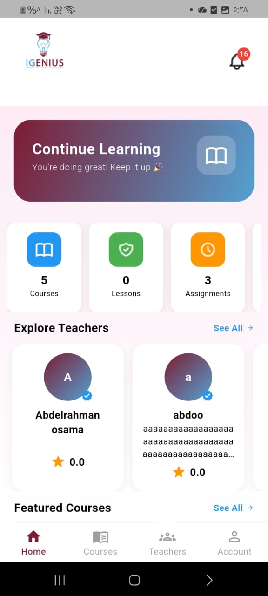
  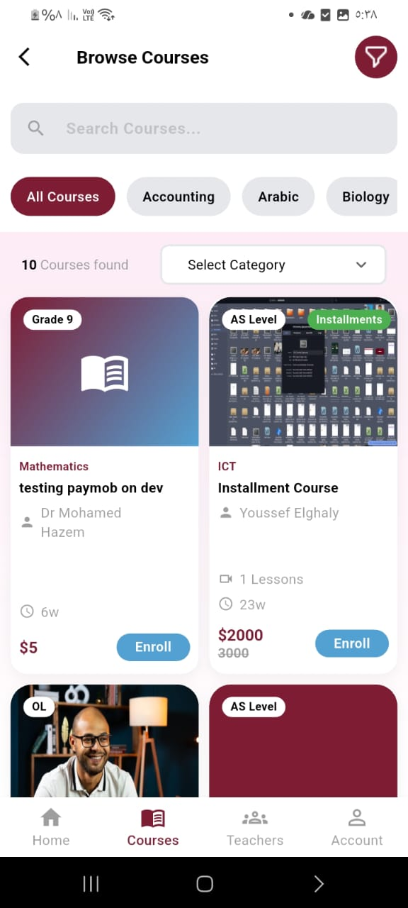
  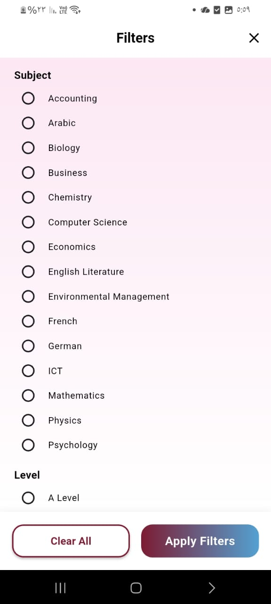
</p>

<p align="center">
  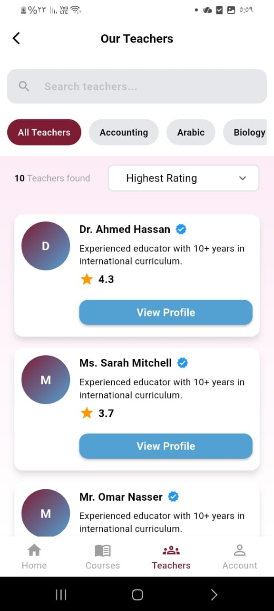
  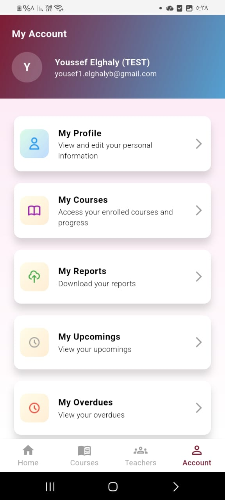
  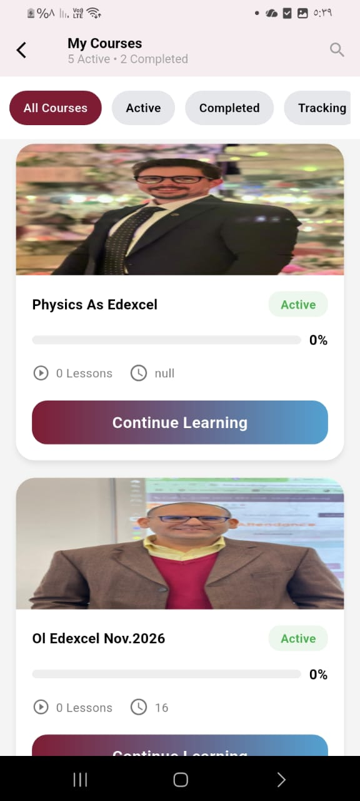
</p>

<p align="center">
  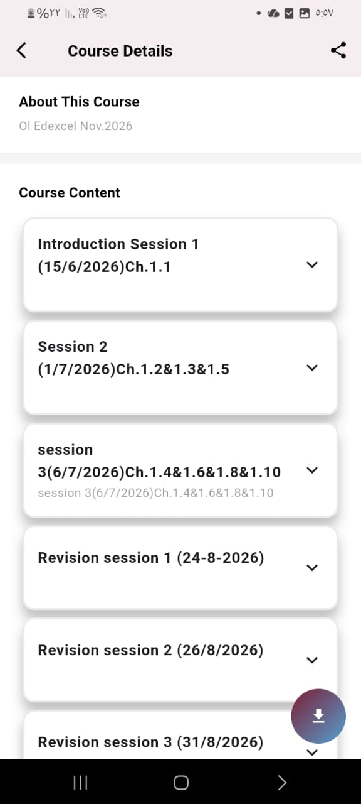
  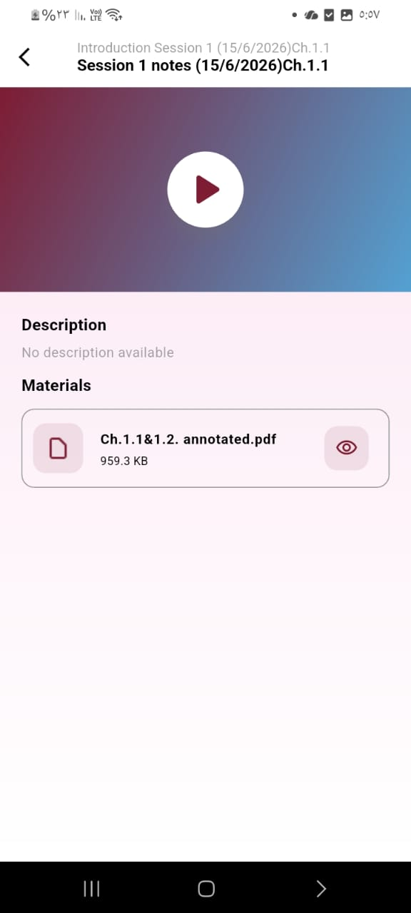
  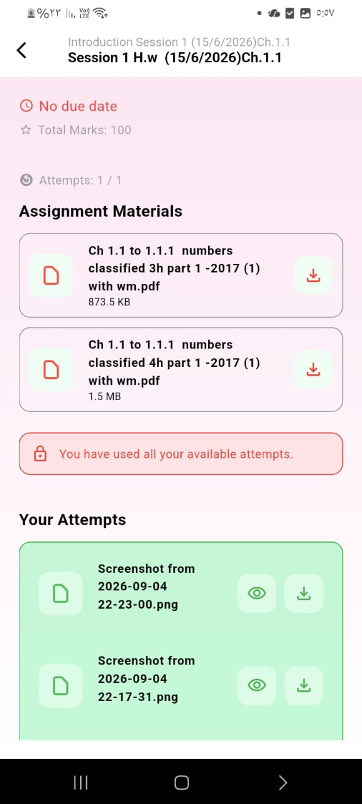
</p>

<p align="center">
  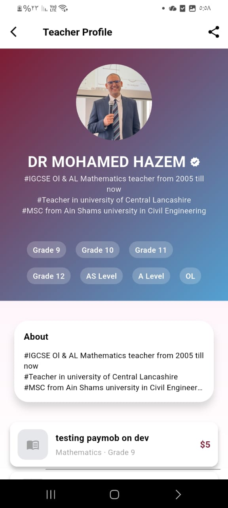
  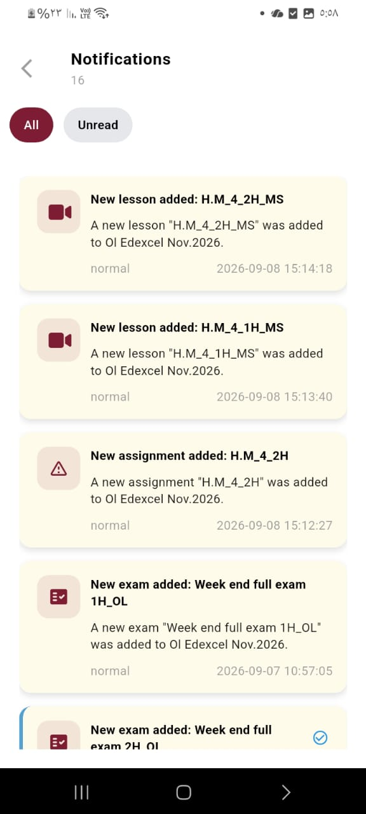
  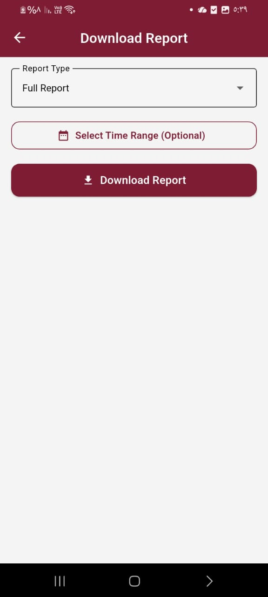
</p>
---

## 📂 Project Structure

The project follows a feature-based structure, keeping each feature organized into separate layers for better maintainability, scalability, and code reusability.

```text
lib/
├── Features/
│   ├── Auth/
│   │   ├── data/
│   │   │   ├── models/
│   │   │   ├── network/
│   │   │   └── repos/
│   │   │
│   │   ├── presentation/
│   │   │   ├── cubits/
│   │   │   └── views/
│   │   │       └── pages/
│   │   │
│   │   └── ...
│   │
│   ├── Home/
│   ├── Courses/
│   ├── Teachers/
│   ├── Lessons/
│   ├── Assignments/
│   ├── Exams/
│   ├── Reports/
│   ├── Notifications/
│   └── Profile/
│
├── core/
│
├── service_locator.dart
└── main.dart
```

---

## 👨‍💻 Developer

Developed using Flutter with a focus on scalable project organization, efficient state management, and delivering a complete educational experience.

### Key Highlights

* Feature-based Project Architecture
* Cubit State Management
* Retrofit API Integration
* RESTful API Communication
* Professional Video Player Integration
* Online & Offline Educational Content
* Fast File Download Management
* Assignment & Exam Submission
* Exam Correction & Result Tracking
* Student Attendance Management
* Academic Reports & Progress Tracking
* Parent Monitoring Features
* Push Notifications & Reminders
* Paymob Payment Integration
* Flexible Installment Plans
* Advanced Search & Filtering
* Course & Teacher Discovery